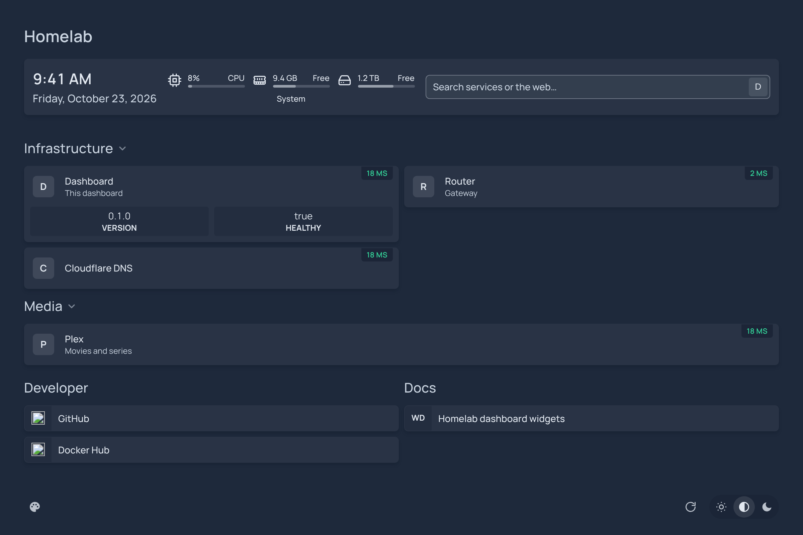
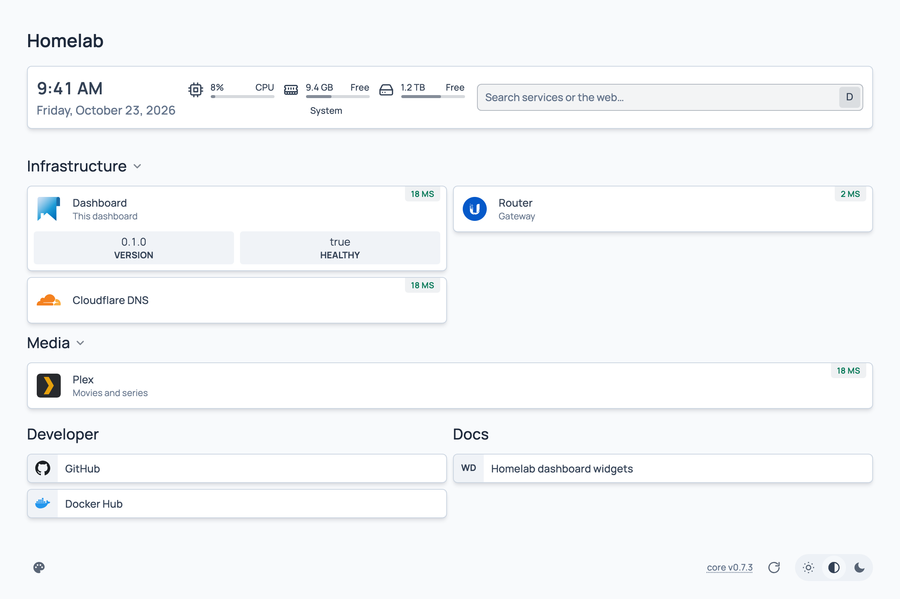

# Homelab Dashboard

A self-hosted start page for your homelab, configured in YAML, in the spirit of
[homepage](https://gethomepage.dev). Its own twist: **widgets are packages anyone can publish**
(a git repository, an npm package or a folder) and pull in with one line of YAML. Nobody has to
get a pull request merged here first.



<details><summary>Light mode</summary>



</details>

## Features

- **YAML configuration** for services, header widgets, bookmarks and discovery, hot-reloaded on save.
- **Status checks** per service: HTTP (`siteMonitor`), `ping`, or Docker container state.
- **Widgets** with live data. Built in: date/time, system resources, search, HTTP status, ping,
  Docker container, and a generic JSON API mapper.
- **Third-party widgets**: `widget.yaml` + `server.js` (+ optional `client.js` Web Component),
  installed from git/npm/path, pinned in a lock file.
- **Secrets stay on the server**: API keys go in `{{HD_VAR_...}}` and never reach the browser.
- **Auto-discovery** of Docker containers (labels) and Kubernetes Ingresses (annotations).
- Five languages (en, nl, fr, de, es), dark/light/auto theme and accent colours.

## Quick start

```bash
docker run -d -p 3000:3000 -v ./config:/config ghcr.io/stefanrenne/homelab-dashboard:latest
```

Images are built for amd64 and arm64: `latest` follows `main`, `0.2.0` / `0.2` are releases.

On first start an empty `config` folder is filled with the example config. Edit the YAML files
and the open page updates by itself. See [docker-compose.example.yml](docker-compose.example.yml)
for Docker discovery through a read-only socket proxy.

```yaml
# services.yaml
- Network:
    - Pi-hole:
        href: http://pihole.lan
        icon: pi-hole.svg            # from dashboard-icons, or /icons/my.svg from config/icons
        siteMonitor: http://pihole.lan
        widget:
          type: custom-api
          url: http://pihole.lan/api/stats/summary
          headers: { X-FTL-SID: "{{HD_VAR_PIHOLE_SID}}" }
          mappings:
            - { field: queries.total, label: Queries }
            - { field: queries.blocked, label: Blocked }
```

## Third-party widgets

Ready-made widgets for Radarr, Sonarr, Bazarr, Prowlarr, SABnzbd, Seerr, Stash, Tautulli,
Tdarr, What's up Docker, Portainer and Unraid come from
[homelab-dashboard-widgets](https://github.com/stefanrenne/homelab-dashboard-widgets), which is
always installed (its newest release). Other widgets are added under `plugins:`:

```yaml
# settings.yaml
plugins:
  - source: git+https://github.com/someone/hd-widget-pihole#v1.2.0
  - source: npm:hd-widget-adguard@2.0.1
  - path: ./my-widgets/garage-door
```

Writing one takes a manifest and one function. Start from
[homelab-dashboard-widget-example](https://github.com/stefanrenne/homelab-dashboard-widget-example), a complete widget repository with tests and a
release workflow, and read [docs/widgets/authoring.md](docs/widgets/authoring.md).

## Documentation

| | |
|---|---|
| [Configuration](docs/configuration.md) | Every YAML file and key, variables, icons |
| [Discovery](docs/discovery.md) | Docker labels, Kubernetes annotations |
| [Writing widgets](docs/widgets/authoring.md) | From template to published package |
| [Widget API reference](docs/widgets/api-reference.md) | `widget.yaml`, `ctx`, result format, `client.js` |
| [Widget security](docs/widgets/security.md) | Trust model, pinning, secrets |
| [Architecture](docs/architecture.md) · [Development](docs/development.md) · [Publishing](docs/publishing.md) · [Decisions](docs/decisions.md) | For contributors |

## License

[MIT](LICENSE)
